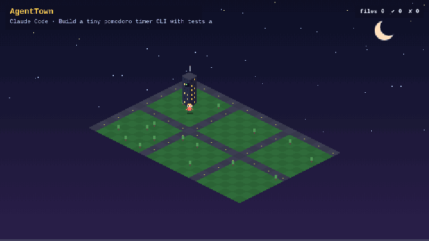

<p align="center">
  
</p>

<h1 align="center">AgentTown 🏙️</h1>

<p align="center"><b>Replay your AI coding agent's session as a living pixel-art town.</b><br>
Files become buildings. Your agent walks between them, reading and building. Failing tests set things on fire. Passing tests set off fireworks.</p>

<p align="center">
  <a href="https://barood-labs.github.io/agenttown/"><b>▶ Try the live demo</b></a> ·
  <a href="#quickstart">Quickstart</a> ·
  <a href="#supported-agents">Supported agents</a> ·
  <a href="#privacy">Privacy</a>
</p>

---

## Quickstart

```bash
npx @barood-labs/agenttown          # replays your most recent Claude Code / Codex session
npx @barood-labs/agenttown --watch  # LIVE: the town builds while your agent works
npx @barood-labs/agenttown --gif town.gif   # render your latest session straight to a GIF
npx @barood-labs/agenttown --demo   # replays the bundled demo session
```

Or install it globally and run `agenttown`:

```bash
npm i -g @barood-labs/agenttown && agenttown
```

From source: `git clone https://github.com/barood-labs/agenttown && cd agenttown && npm install && npm run build && node cli/agenttown.mjs`

No install at all? Open **[barood-labs.github.io/agenttown](https://barood-labs.github.io/agenttown/)** and drag a session `.jsonl` file onto the page.

```text
agenttown                  replay your latest session
agenttown <file.jsonl>     replay a specific session
agenttown --list           list recent sessions
agenttown --pick 3         replay session #3 from the list
agenttown --watch          live mode: follow your newest session as it is written
agenttown <file> --watch   live mode on one specific session file
agenttown --gif out.gif    render a session to a GIF (headless Chrome/Edge if installed, else your browser)
agenttown --demo           replay the bundled demo session
agenttown --port 8080 --no-open
```

## Live mode

```bash
npx @barood-labs/agenttown --watch
```

Leave it open in a browser tab next to your terminal. The CLI tails the session file (`~/.claude/projects/…` or `~/.codex/sessions/…`) and streams new lines to the page over Server-Sent Events, so every read, edit and test run shows up in the town a moment after the agent does it. Without a file argument it follows your **newest** session and switches automatically when you start a new one. Still local-only on `127.0.0.1`.

## What you'll see

| In the session | In the town |
| --- | --- |
| A file is read | The agent walks over, and the building lights up 🔍 |
| A file is created or edited | Scaffolding goes up and the building grows a floor 🔨 |
| Folders | Districts (city blocks), labelled with the folder name |
| Shell commands and thinking | The agent heads back to the terminal tower at HQ |
| Tests fail ❌ | The last-edited building catches fire and smokes until fixed |
| Tests pass ✅ | Fireworks over the whole town 🎆 |
| Subagents (`Task` / `Agent`, Codex sub-agents) | A second worker walks out of HQ to help 👷 |
| Web search / fetch | Globe bubble 🌐 |
| `TodoWrite` / Codex `update_plan` | Checklist bubble ✅ |
| MCP tools (`mcp__server__tool`) | Plug bubble 🔌 |
| Context compaction | The town flashes while the context is squeezed |
| A failed patch or non-zero exit | ✘ bubble over the agent |
| Tokens | A running counter in the corner (counted once per API response) |

**Hover a building** to see its path, floors, edits, reads, failing test runs and the last action on it. Click to pin the card.

Controls: play/pause (space), scrub the timeline, 0.5× to 8× speed, **Export GIF** (frame-exact) or **Export WebM** to share your replay.

## Supported agents

| Agent | Where the logs live | Status |
| --- | --- | --- |
| **Claude Code** | `~/.claude/projects/<project>/*.jsonl` | ✅ Supported, incl. resumed sessions, subagents, MCP, web tools, compaction |
| **OpenAI Codex CLI** | `~/.codex/sessions/YYYY/MM/DD/rollout-*.jsonl` | ✅ Supported, incl. `exec_command`, `apply_patch`, web search, plans, compaction |
| **Gemini CLI / OpenCode** | | 🚧 Planned |
| **Cursor** | SQLite (`state.vscdb`), no JSONL export | 🚧 Not yet. PRs welcome |

Tests are detected from shell commands like `npm test`, `pytest`, `cargo test`, `go test`, `vitest` and `jest`, and pass/fail comes from the exit code (Claude `is_error`, Codex `Exit code: N` / `Process exited with code N`) or the output. Subagent transcripts (`<session>/subagents/agent-*.jsonl`) are never picked as your "latest" session.

## Privacy

**Everything runs locally.** The CLI serves the viewer on `127.0.0.1` only, and the web version reads your file in the browser with the File API. Nothing is uploaded, there is no analytics, and there are no network calls besides loading the page itself. The bundled demo sessions in `public/samples/` are synthetic and generated by `scripts/make-samples.mjs`.

Session logs can contain code, paths and prompts, so check a GIF before you share it.

## How it works

- `src/parser.ts` turns Claude Code and Codex JSONL into one stream of events: `read`, `edit`, `write`, `bash`, `test_pass`, `test_fail` and so on.
- `src/town.ts` is a deterministic isometric renderer on a 480×270 Canvas, upscaled with nearest-neighbour. Every frame is a pure function of `(session, t)`, so scrubbing and export are exact.
- All art (buildings, the agent sprite, smoke and fireworks) is drawn in code. There are no image assets.
- `cli/agenttown.mjs` is a zero-dependency Node server that finds your latest session, tails it for `--watch` (SSE), and drives headless Chrome for `--gif`.
- `test/fixtures/` holds anonymised fixtures modelled on the current Claude Code and Codex formats.

```bash
npm run dev       # Vite dev server
npm test          # parser tests
npm run samples   # regenerate the synthetic demo sessions
node scripts/record-hero.mjs   # re-record docs/hero.gif headlessly (Playwright + ffmpeg)
```

## Ideas / roadmap

- Cursor, Gemini CLI, OpenCode and Aider support
- Day/night cycle and idle-gap compression from real timestamps
- Redaction before export
- Share links that encode a redacted session in the URL

## License

MIT © barood-labs. All pixel art is original and drawn programmatically.
